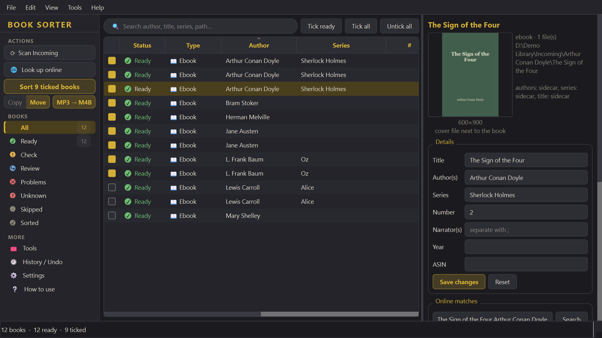
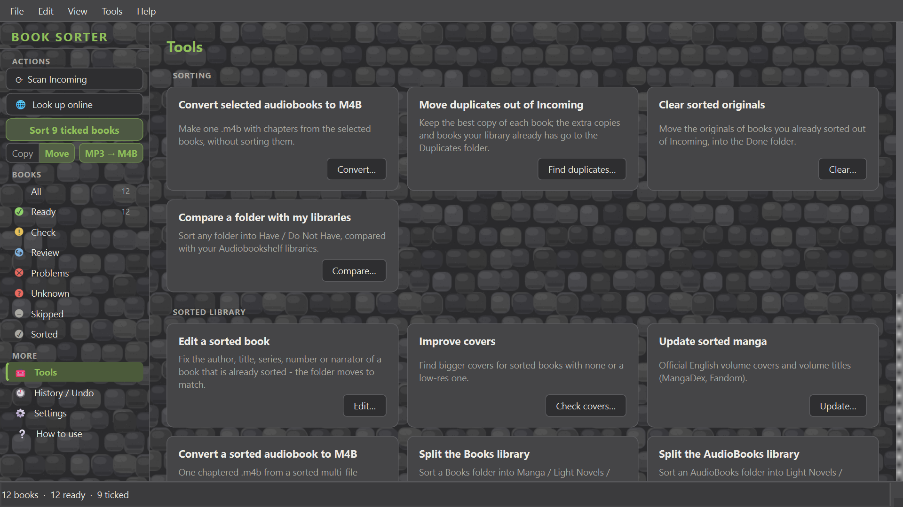
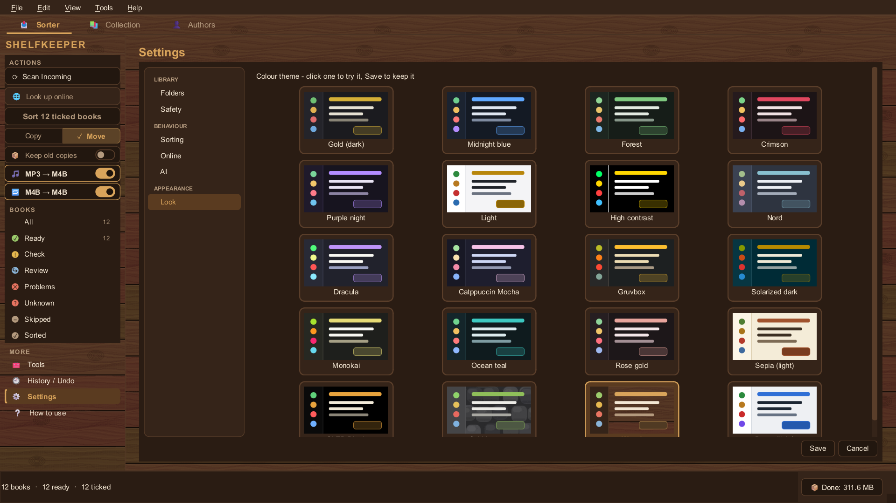

# Shelfkeeper

*(formerly AudioBooks & EBook Sorter - the Book Collection Checker is part of it now)*

> **Work in progress.** It sorts my own library every day, but expect rough edges, changes and bugs.

A Windows desktop app that sorts audiobooks, ebooks, manga and light novels into a clean
[Audiobookshelf](https://www.audiobookshelf.org/)-friendly layout:

```
Sorted\AudioBooks\Audiobooks\<Author>\<Series>\<N> - <Title>\
Sorted\AudioBooks\Light Novels\...
Sorted\Books\Manga\<Author>\<Series> (Manga)\<N> - <Series>, Vol. N\
Sorted\Books\Light Novels\...   Sorted\Books\EBooks\...   Sorted\Books\Comics\...
```



## What it does

- **Reads what the files already know** - tags (mp3 / m4b / flac / ogg), `metadata.opf`, Audiobookshelf's
  `metadata.json`, DAISY talking books (`ncc.html`), epub / cbz contents, file and folder names.
- **Looks books up online** - Audible, Storytel, AniList (manga & light novels), Apple Books, Google Books,
  Open Library, MangaDex covers and Fandom wikis for volume titles. Only exact, confident matches are applied;
  everything else waits for you ("Check").
- **Sorts safely** - copy or move, never overwrites, every run can be undone from History, and your real
  library folders are protected (the app never writes there).
- **Knows the difference** between manga, comics, light novels and ebooks, keeps a series under one author,
  handles spin-offs, "Part N Volume M" numbering, romanised name spellings and more.
- **Audio tools** - MP3 → one chaptered M4B (chapter names from Audible or snapped to silences), fixes
  xHE-AAC files Audiobookshelf can't play (Windows' own decoder).
- **Covers** - picks the best one (English edition first, bigger beats thumbnails), can improve covers of
  sorted books and put them inside the m4b.
- **Library tools** - duplicates (keeps the best copy), compare a folder with your libraries (Have / Do Not
  Have), edit a sorted book, sort Audiobookshelf collections into reading order.
- **Your library: Collection** - every series you have (read from Audiobookshelf), per kind (audiobook,
  light novel, manga, ebook) what you have, what's missing and what's coming - with a release calendar.
  This was the separate *Book Collection Checker*; its settings and saved lookups are taken over on first use.
- **Your library: Authors** - type an author and see everything Audible, AniList, Google Books and Open Library
  know of them, next to what you have. Right-click a book or series: *More by <author>*.
- **20 colour themes** - including OLED Black, and a couple of textured ones (Cobblestone, Wood).

| Tools | Themes |
|---|---|
|  |  |

## Upgrading from AudioBooks & EBook Sorter

Put `Shelfkeeper.exe` where `BookSorter.exe` was and start it: the `BookSorter-data` folder next to it (or
`%APPDATA%\BookSorter` / `%LOCALAPPDATA%\BookSorter`) is renamed to `Shelfkeeper-data` (`...\Shelfkeeper`)
and the paths saved inside are updated, so History / Undo of older runs keeps working. Then delete
`BookSorter.exe`.

## Download

Grab the latest [release](https://github.com/Farathim89/shelfkeeper/releases):

- **`Shelfkeeper-portable.zip`** - unzip anywhere (USB stick too) and run `Shelfkeeper.exe`. Everything it saves
  (settings, history/undo, cache, ffmpeg, window layout) stays in the `Shelfkeeper-data` folder next to it.
- **`Shelfkeeper.exe`** - the same app on its own; it keeps its settings in your user profile.

No install and no Python needed. Windows 10/11; online lookups need internet.

## Run from source

Windows 10/11, Python 3.10+.

```bash
python -m venv .venv
.venv\Scripts\pip install -r requirements.txt
.venv\Scripts\python shelfkeeper.pyw
```

On first start it asks for your folders (Incoming, Sorted, and your library folders to protect).
[ffmpeg](https://ffmpeg.org/) is only needed for the M4B and xHE-AAC tools - the app can download it for you.

Command line (same engine, no window):

```bash
.venv\Scripts\python -m app.cli --help
```

## Build the .exe

```bash
build.cmd
```

gives `dist\Shelfkeeper.exe` (PyInstaller, one file).

## Tests

```bash
.venv\Scripts\python -m pytest
```

## License

[MIT](LICENSE) © Farathim
